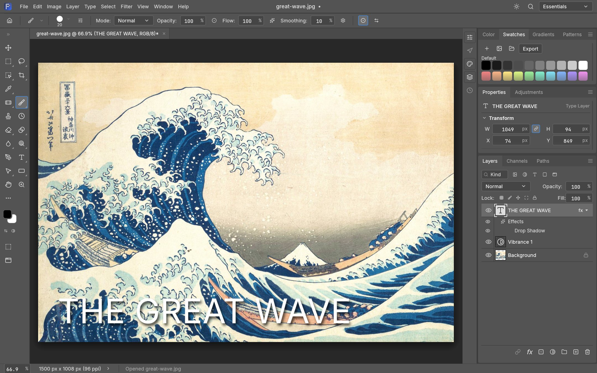
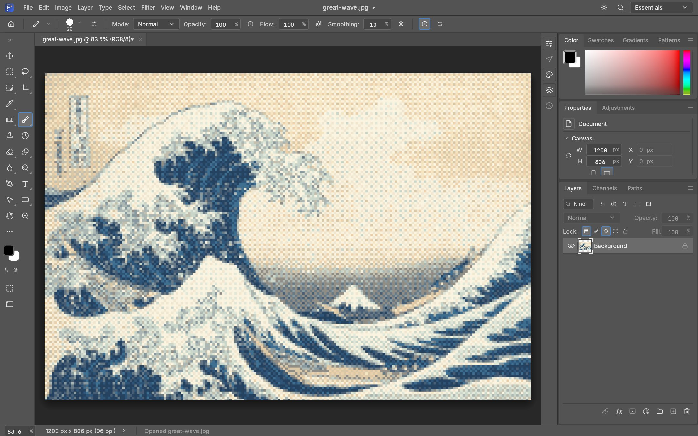
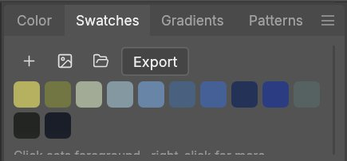
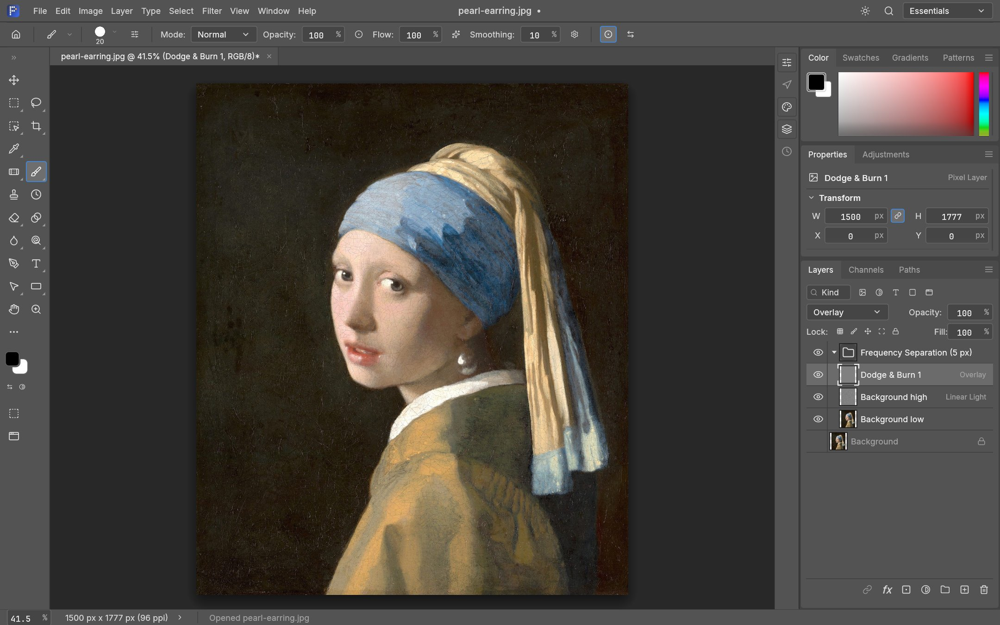

<h1 align="center">Pixelwright</h1>

<p align="center">
  <b>A native, open-source image editor written entirely in Rust.</b><br>
  Layers, masks, adjustment layers, live type, vectors, brushes and real PSD files, on a GPU compositor,<br>
  with a scriptable command line, an MCP server for AI agents, and the very same editor running in your browser.
</p>

<p align="center">
  
  
  
  
</p>

<p align="center">
  <a href="https://www.jonmcgee.online/apps/pixelwright/"><b>Try it in your browser</b></a> ·
  <a href="#get-started">Build it</a> ·
  <a href="#whats-new-in-this-fork">What's new</a> ·
  <a href="#honest-status">Honest status</a> ·
  <a href="#credits-and-license">Credits</a>
</p>

<p align="center">
  
  <br>
  <sub>The real app, rendered offscreen on public-domain art. <i>The Great Wave off Kanagawa</i>, Katsushika Hokusai, c. 1831</sub>
</p>

## What it is

Pixelwright is a fork of [PhotoCraft](https://github.com/storytold/photocraft) v0.5.0, an early-alpha, clean-room, Rust-only layered image editor by the ArtCraft team and contributors. It keeps their engine (a pure-data document model, a command registry that every action goes through, a CPU reference compositor and a wgpu one) and builds on it: bugs found and fixed, stale roadmap rows corrected, and a set of new features listed [below](#whats-new-in-this-fork).

Three programs come out of this repository:

| Program | What it is |
|---|---|
| **Pixelwright** (`pixelwright`) | The native desktop editor (egui on wgpu) for Windows, macOS and Linux |
| **Pixelwright CLI** (`pixelwright-cli`) | Headless: convert, inspect, run commands, batch, droplets, palette, diff, and an MCP server |
| **Pixelwright Web** (`pixelwright-web`) | The same editor compiled to WebAssembly (trunk + wasm-bindgen), running in any modern browser |

## Try it now

The live preview is the real program compiled to WebAssembly, running entirely in your browser tab:
**<https://www.jonmcgee.online/apps/pixelwright/>**. It needs WebGPU or WebGL2, downloads about 9 MB (22 MB unpacked) once, and starts with a few public-domain images you can open from the start screen (or drop in your own files, including PSDs; nothing is uploaded anywhere).

## What you get

<table>
  <tr>
    <td width="33%" valign="top">
      <h4>🗃️ Layers, done properly</h4>
      Groups, clipping masks, pixel and vector masks, fill and adjustment layers, live smart objects with smart filters, 27 blend modes, opacity and fill, locks, layer styles (drop shadow, glows, bevel, satin, strokes, overlays), multi-layer selection with align and distribute.
    </td>
    <td width="33%" valign="top">
      <h4>🎨 Any colour, any depth</h4>
      RGB, Grayscale, CMYK and Lab documents at 8, 16 and 32 bits per channel. Bit depth and colour model are runtime data, so every tool works at every depth. ICC colour management in pure Rust: embedded profiles, soft proofing, gamut warning.
    </td>
    <td width="33%" valign="top">
      <h4>🗂️ Real files</h4>
      PSD and PSB (169 of 170 corpus files re-import identically), layered TIFF, PNG, JPEG, WebP, GIF, TIFF, OpenEXR, HDR, AVIF, HEIC (read), camera RAW (DNG, CR2, ARW, RW2, ORF), and the native lossless <code>.pxwr</code> bundle. Files saved by PhotoCraft (<code>.pcraft</code>) still open.
    </td>
  </tr>
  <tr>
    <td valign="top">
      <h4>🧰 34 tools and a real brush engine</h4>
      Move, marquees, lassos (including Magnetic), Quick Selection, Magic Wand, Crop, Eyedropper, Brush, Pencil, Mixer Brush, Eraser, Clone Stamp, Healing, Patch, Gradient, Pen, Type, Shapes and more. Pressure and tilt on Windows, macOS, Linux (X11) and the web.
    </td>
    <td valign="top">
      <h4>🎛️ 70+ filters, 16 adjustment layers</h4>
      Every filter previews live through your selection: blurs and the Blur Gallery, sharpen, noise, distort, stylize, render, Liquify, Camera Raw. Curves, Levels, Hue/Saturation, Selective Color, Gradient Map, Color Lookup and more.
    </td>
    <td valign="top">
      <h4>🤖 Agent-ready</h4>
      Every menu item, tool and dialog runs a command from one registry of 500+ commands. The UI, the CLI, a JSON control channel and the MCP server all dispatch the same ids, so anything you can click, a script or an AI agent can do.
    </td>
  </tr>
</table>

## What's new in this fork

First fixes and finished features from the roadmap, then additions of my own. Everything below is a registered command, so it appears in the menus and the command palette (⌘/Ctrl+K) and works from the CLI and MCP. Each has tests; the translation tables cover all 12 translated UI languages.

<table>
  <tr>
    <td width="50%" valign="top">
      
      <br>
      <sub>Filter › Pixelate › <b>Pixel Art…</b> on <i>The Great Wave</i>: 6 px cells, 16 colours, ordered dither.</sub>
      <h4>Pixel Art</h4>
      Averages cells, reduces them to a small palette (the Indexed Color palette builders and dithers) and scales them back up. <code>filter.pixelate.pixelArt</code>: cell size, colour count, dither (none, pattern, diffusion, noise), palette (perceptual, adaptive). Honours the selection.
    </td>
    <td width="50%" valign="top">
      
      <br>
      <sub>A palette taken from the open image, added to the library as its own group.</sub>
      <h4>A real swatch library</h4>
      The Swatches panel was a fixed set of 40 colours. It is now a library in named groups that persists, with <b>Palette from Image</b> (perceptual median cut, ranked by share), <b>.aco and .ase import and export</b> (also via File › Open and drag-and-drop), tooltips, and a right-click menu. <code>swatch.presets.*</code>
    </td>
  </tr>
</table>

<p align="center">
  
  <br>
  <sub>Layer › New › Frequency Separation, then Dodge &amp; Burn Layer. The Low and High layers sit in a group; the original is hidden, not lost.<br><i>Girl with a Pearl Earring</i>, Johannes Vermeer, c. 1665</sub>
</p>

| Feature | Where | What it does |
|---|---|---|
| **Frequency Separation…** | Layer › New · `layer.frequencySeparation` | Splits a pixel layer into a blurred *low* layer and a Linear Light *high* layer inside a group, the standard non-destructive retouching setup. The two stack back to the original exactly (tested at 8, 16 and 32 bits); the original is hidden, not removed. |
| **Dodge & Burn Layer** | Layer › New · `layer.newDodgeBurn` | A 50 % grey Overlay (or Soft Light) layer to paint light and shadow onto without touching pixels. |
| **Orton Glow…** | Layer › New · `layer.ortonGlow` | A blurred copy in Screen mode; its opacity is the amount, so the glow stays adjustable. |
| **Straighten Horizon** | Image › Image Rotation · `image.autoStraighten` | Measures the dominant near-horizontal or near-vertical edge direction from the composite and levels the image (rotate and crop, one undo step). `"apply": false` only measures. On Ansel Adams' *Tetons* tilted by a known 4° it measures −3.98° and restores the picture; on the level photo it refuses (confidence 0.05). |
| **Colour-blindness proofing** | View › Proof Setup | Adds **Tritanopia** (blue-yellow, Machado et al. 2009) and **Achromatopsia** (luminance only) to the protanopia and deuteranopia simulations. |
| **Open and Save start where you left off** | desktop | File › Open and Save As remember the last folder, across restarts. |
| **Recent commands in the palette** | ⌘/Ctrl+K | An empty query lists what you ran last, newest first. |
| **Open `.pcraft`** | desktop, web, CLI | PhotoCraft's native bundles open as they are; saving writes `.pxwr`. |
| **`?open=` and samples** | web | `…/index.html?open=samples/tetons.jpg` opens an image at startup (same-origin paths only); the start screen offers four public-domain samples. |
| **`pixelwright-cli palette`** | CLI | The dominant colours of any image or document: `--count`, `--sort prominence\|hue\|lightness`, `--format text\|json\|hex`. |
| **`pixelwright-cli diff`** | CLI | Compares two images or documents (any format, flattened): mean error, RMSE, PSNR, differing pixels, an optional heat-map, and `--fail` to gate CI on a threshold. |

Fixes and corrections: the synthetic CMYK ICC profile, the example plug-in and the tests that the rename touched; two scorecard rows (Smudge fringe, Sample All Layers) that were stale were verified against the code and its tests and corrected; a clippy-clean, never-panic code base is kept (`panic_hunt` fuzzes the new commands too). The full list is in [`docs/fork-changes.md`](docs/fork-changes.md).

## Honest status

Pixelwright is **early alpha**, and so is what it was forked from. Much of Photoshop's feature surface exists in some form, **but it is not yet a replacement for daily professional work.** In [the upstream roadmap's own assessment](docs/roadmap.md#honest-parity-assessment-2026-10-05):

- **Solid:** layered editing, masks, adjustment layers, the colour-managed canvas, PSD round trips within the test corpus, the brush engine, the CLI and MCP.
- **Rough:** many interaction details (the scorecard counts 57 of 135 preferences that nothing reads), 22 of 38 performance budgets missed on the upstream baseline machine, a documented GPU-compositor crash with a 150-layer document, complex layout PSDs that feel laggy.
- **Missing:** AI and generative features (none), about twenty tools (Pen variants, Rotate View, Perspective Crop and others), type on a path, SVG and PDF import, scripting compatibility with Photoshop actions, and the plug-in ecosystem (plug-ins here are sandboxed WebAssembly).

[`docs/scorecard.md`](docs/scorecard.md) has the measured numbers; [`docs/parity.md`](docs/parity.md) counts menu *wiring* only, which is not behaviour.

## Get started

You need Rust 1.95 or newer. On Linux: `libxkbcommon-dev libwayland-dev libx11-dev libxrandr-dev libxi-dev libgl1-mesa-dev libgtk-3-dev`.

```sh
git clone https://github.com/game7ballJT/pixelwright
cd pixelwright
cargo run --release -p pixelwright -- image.psd      # the desktop app
cargo test --workspace                               # the test suite (several thousand tests)
```

The browser build (needs [`trunk`](https://trunkrs.dev) and `rustup target add wasm32-unknown-unknown`):

```sh
cd apps/pixelwright-web
trunk build --release        # writes ../../dist/web: index.html, the wasm-bindgen glue, the .wasm and samples/
trunk serve --release        # dev server on http://127.0.0.1:8765
```

### Command line

```sh
# Headless: open, edit, save
pixelwright-cli run wave.psd \
  --cmd filter.sharpen.smartSharpen     --params '{"amount":80}' \
  --cmd layer.newAdjustmentLayer.curves --params '{"points":[[0,0],[64,48],[192,212],[255,255]]}' \
  --out wave-final.png

pixelwright-cli palette wave.psd --count 6 --format hex          # the six dominant colours
pixelwright-cli diff before.png after.png --out heat.png --fail  # compare, with a heat-map
pixelwright-cli batch --actions grade.json --in ./raw --out ./graded
pixelwright-cli commands --filter blur                           # the command registry
pixelwright-cli mcp                                              # serve MCP on stdio for an agent
```

The desktop app also offers an authenticated, loopback-only control channel (`pixelwright --control 7878`) for inspecting UI state, driving tools with pointer events and taking offscreen screenshots; see [`docs/control-protocol.md`](docs/control-protocol.md).

### Where things are

```text
crates/
  geom cms color raster      foundation: geometry, ICC colour, pixel formats and blend maths, copy-on-write tiles
  psd codecs raw heif tablet standalone format crates (PSD/PSB, ACO/ASE, image codecs, camera RAW, HEIC, pen input)
  doc ops algo paint text vector   document model, history, imaging algorithms, brush engine, type, paths
  compose gpu format io plugins    compositors (CPU oracle, wgpu), native format, import/export, WebAssembly plug-ins
  engine                           Session + the command registry: every action is a command
  ui-egui automation               the egui shell (thin) and the MCP server
apps/  pixelwright  pixelwright-cli  pixelwright-web
```

Layering is enforced by `cargo xtask layers`; the engine never sees the UI toolkit. New contributors and AI agents: read [`AGENTS.md`](AGENTS.md), then [`docs/`](docs/). The long-form documentation is in [`book/`](book/).

## Credits and license

Pixelwright is a modified fork of **[PhotoCraft](https://github.com/storytold/photocraft) v0.5.0**, copyright (c) 2026 the ArtCraft Team and the PhotoCraft contributors, whose work this repository builds on and whose history it preserves. All of it, and the changes made here, are available under the same terms: [MIT](LICENSE-MIT) or [Apache-2.0](LICENSE-APACHE), at your option. This fork is independent and is not affiliated with or endorsed by the upstream authors; it carries none of their branding, as their brand license requires of forks. Required notices are in [NOTICE](NOTICE).

Bundled fonts, icons, images and other assets keep their own open licenses; each one is listed with its author, source and license in [ATTRIBUTION.md](ATTRIBUTION.md). Every artwork shown (and the four web samples) is in the public domain; sources are in [`docs/images/SOURCES.md`](docs/images/SOURCES.md). The app icon is original work made for this project.

<sub>Adobe, Photoshop and other product names are trademarks or registered trademarks of Adobe Inc. in the United States and/or other countries. Pixelwright is an independent open-source project, is not affiliated with, sponsored by or endorsed by Adobe Inc., and uses these names only to describe the file formats and workflows it is compatible with.</sub>
